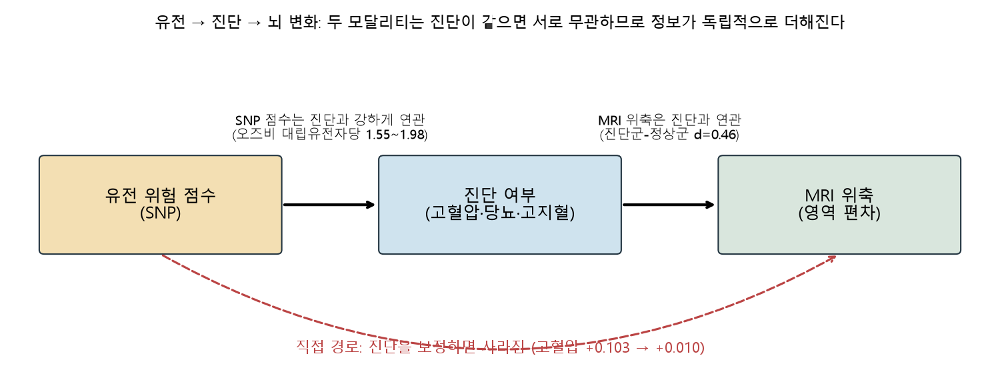
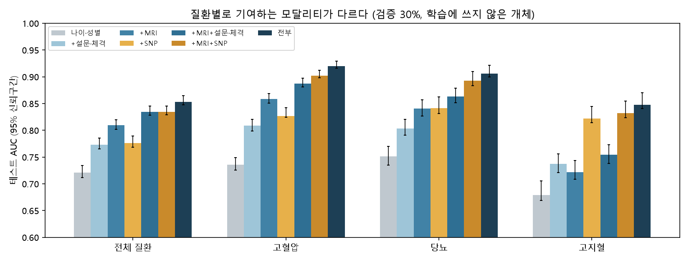
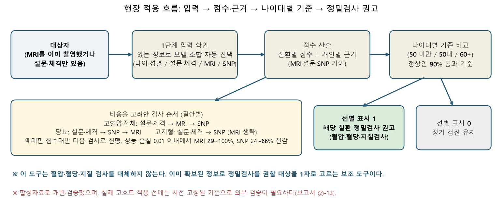

# 코호트 기반 헬스케어 인공지능 결과 보고서 (초안)

> 이 초안은 대회 공식 양식(팀명·모델명·주요 활용 데이터·연구요약·기대효과 / 1-1~1-4)의 구조를 따른다. 수치는 이 폴더의 `results/`, `model/` 파일에서 나온 값이며, 확인되지 않은 주장은 쓰지 않았다. 팀명, 팀원, 그림은 최종 제출 전에 채운다.

- **팀명**: (작성)
- **모델명**: 결측 강건 멀티모달 대사질환 선별 모델 + 합성 코호트 충실도 점검
- **주요 활용 데이터**: 대회 제공 BASE 합성데이터 1만 명(임상·뇌 MRI 체적·유전체 100만 SNP), FOLLOW 1·5차(외부 평가), 외부 실제 자료 DLBS·ADNI(합성자료 충실도 비교와 재현 확인)

## 연구요약

이 연구의 기여는 새 알고리즘이 아니라, **멀티모달 코호트에서 대사질환(고혈압·당뇨·고지혈) 선별을 얼마나 믿을 수 있는지, 그리고 어떤 검사를 언제 추가할 가치가 있는지를 엄격하게 따지는 설계와 분석**이다. 세 가지로 구성된다.

1. **합성 코호트 충실도 감사 키트**: 대회 합성자료를 실제 자료(DLBS·ADNI)와 대조해 한 명령으로 점검한다. 횡단 나이·ICV 효과는 실제와 유사했지만, 종단 위축 속도의 나이 의존성은 실제와 반대였고, 심실 변수 4개는 고정 상한에 걸려 있었으며, MRI 신호는 측정 수치(혈압 등)보다 진단 여부에 묶여 있었다. 합성자료 위의 성능을 해석하는 한계이자 자료 개선 피드백이다.
2. **질환별 순차 선별**: 모든 검사를 다 하지 않고 설문·체격 → (질환마다 다른 순서로) MRI·SNP를 필요한 사람에게만 추가한다. 성능 손실 0.01 이내에서 MRI는 29~100%, SNP는 24~66%를 줄일 수 있었다(고지혈은 MRI 생략, 당뇨는 SNP 우선).
3. **"유전 → 진단 → 뇌 변화" 매개 구조의 검정**: 유전 위험 점수와 MRI 위축의 연관은 진단 여부를 보정하면 사라진다(고혈압 +0.103 → +0.010). 그래서 두 모달리티는 진단이 같으면 서로 독립인 정보이고 성능이 더해진다. 고혈압은 MRI, 고지혈은 SNP, 당뇨는 둘 다 기여하는 질환별 차이도 이 구조로 설명된다.

이 분석을 위한 기반으로 **MRI, 설문·체격, SNP 중 입력에 있는 모달리티만으로 가능한 가장 풍부한 조합을 자동 선택하는 선별 모델**을 만들었다. 정상 참조(병이 없는 사람)에서의 영역별 편차를 쓰는 규제 로지스틱 모델이며, 알고리즘은 일부러 표준적인 것을 썼다. 성능 변화의 원인을 모달리티 기여로만 귀속시키기 위해서다. BASE 라벨 개체 8,223명 전체에 대한 5겹 교차검증(2회 반복)에서 매 폴드의 정상 참조 구성, SNP 선택, 점수 학습을 학습 개체 안에서만 했고, 나이·성별만 쓴 기준(AUC 0.68~0.75) 대비 세 모달리티를 모두 쓴 AUC는 **전체 질환 0.85, 고혈압 0.92, 당뇨 0.91, 고지혈 0.85**였다. 최종 모델은 전체 라벨 개체로 다시 학습했다.

평가는 낙관적이지 않도록 다각도로 점검했다. 진단은 없으나 측정값이 비정상인 사람을 음성에 포함하면 AUC가 0.012~0.019 낮아지고, 합성자료의 SNP 효과가 실제보다 매우 크므로 SNP 계수를 실제 GWAS 수준으로 줄이면 SNP의 AUC 이득은 +0.005~0.04로 작아진다(MRI·설문의 기여는 그대로). SNP를 쓰지 않는 MRI·설문 모델은 서로 다른 사람인 FOLLOW 1차(785명)에서도 AUC 0.82로 재현되었다(전체 질환). 조건별 성능은 1-2절의 요약표에 모았다.

## 기대효과

1. **이미 촬영된 MRI의 추가 활용(기회적 선별)**: 이 모델은 혈압·혈당·지질 검사를 대체하지 않는다. 다른 이유로 이미 MRI를 촬영한 사람에게 추가 촬영 없이 설문·체격·유전 정보를 더해, 대사질환 정밀검사를 권할 대상을 1차로 고르는 보조 도구다. 정상인의 90%를 맞게 통과시키는 기준에서 환자의 약 51~78%(질환·나이대에 따라)를 잡으므로(나이대별 기준) 확진 도구가 아니라 검사 권고 대상을 고르는 용도에 맞다. 대상자 100명당 권고·적중·놓침 인원, 성별·나이대별 성능, 실제 코호트용 사전 고정 검증 계획은 ②-13에 있다.
2. **검사 비용을 고려한 순서 제안**: MRI가 없는 환경에서는 설문·체격과 SNP로 먼저 선별하고, MRI는 효과가 있는 질환(고혈압·당뇨)의 애매한 사람에게만 추가한다. 설문·체격만으로 AUC 0.77(전체 질환)이지만 MRI를 더하면 0.84, SNP까지 더하면 0.85로 오른다.
3. **모달리티 투자 판단 근거**: 질환별로 MRI와 유전체 중 무엇이 효과가 큰지 보여주어, 추가 검사 우선순위를 정하는 근거가 된다.
4. **합성데이터 품질 관리**: 충실도 점검 항목은 합성 코호트를 만드는 쪽과 쓰는 쪽 모두에게 재사용 가능한 체크리스트다.

---

## ① 연구 활용 개요

### 1-1. 활용 배경

대사질환(고혈압·당뇨·고지혈)은 조기 발견이 중요하지만, 모든 검진 현장에 혈액검사와 영상, 유전체가 함께 있지는 않다. 실제 코호트 자료는 대상자마다 가용한 정보가 다르다. 따라서 "모든 모달리티가 있어야만 작동하는 모델"보다 **있는 정보만으로 작동하고, 정보가 늘면 성능이 오르는 모델**이 필요하다. 이 연구는 이 상황을 대회 제공 멀티모달 합성 코호트에서 검증 가능한 형태로 구현했다.

### 1-2. 모델 소개

**입력 모달리티**
- 나이·성별
- MRI 체적표: 정상군만으로 만든 정상 참조에서 영역별 편차(z)를 계산한다. 뇌연령(BAG)도 계산하지만 영역 편차에 비해 추가 기여가 없어 해석용 출력으로만 둔다.
- 설문·체격: 음주·흡연·운동·가족력·BMI·허리둘레
- SNP: 질환별 대표 변이 15개(학습 70%에서 전장 스캔으로 선택, 1Mb 이내 중복 제거)

**구성**
1. 정상 참조(병이 없는 사람의 60%)로 영역별 정상 기댓값과 편차를 만든다.
2. 점수 학습은 참조에 쓰지 않은 사람(정상군 나머지와 질환군)으로 한다. 같은 사람을 참조와 학습에 같이 쓰면 정상군이 더 정상처럼 보이는 편향이 생기기 때문이다.
3. 질환 4종(전체·고혈압·당뇨·고지혈) × 모달리티 조합 8종을 각각 규제 로지스틱으로 학습한다.
4. 예측 시 입력에 있는 모달리티로 가능한 가장 풍부한 조합을 자동 선택한다.

**출력**: 질환별 선별 점수(순위용)와 보정 확률(`prob_*`, 표본 유병률 기준이며 `--prevalence`로 대상 집단 유병률 환산 가능), **나이대별(50세 미만 / 50대 / 60세 이상) 특이도 90% 기준**의 선별 표시, BAG(년)와 가장 벗어난 영역 3개, 그리고 **개인별 근거 분해**(`why_*` 열). 근거 분해는 점수(로짓)를 나이·성별, MRI, 설문·체격, SNP, 절편의 기여로 나눈 것으로, 모델이 선형이라 합이 점수와 정확히 일치한다(양수는 질환 쪽으로 민 정도). 나이대별 기준을 쓰는 이유는 ②-11에 있다. 예제는 `model/example_output_*.csv`.

> **개인 예시(학습에 쓰지 않은 검증 개체, 69세 여성, 실제로 고혈압)**: 고혈압 점수 0.852, 선별 표시 1. 근거는 설문·체격 +1.07, 나이·성별 +0.48, MRI +0.28, SNP +0.04, 절편 −0.12(합 1.75 = 점수 0.852). 이 사람은 MRI보다 설문·체격과 나이가 점수를 끌어올렸다. 같은 사람의 전체 질환 점수는 0.883으로 높지만 60세 이상 기준이 높아 선별 표시는 0이다. 한 명의 결과는 성능 증거가 아니라 출력 형식의 예시이다.

**정의**: 정상은 자기보고 고혈압·당뇨·고지혈이 없고 수축기 <140, 이완기 <90, 공복혈당 <126, HbA1c <6.5, 총콜레스테롤 <240인 사람이다. 자기보고가 있으면 질환이다. 그 외(진단은 없으나 측정값이 비정상)는 학습·평가에서 제외했다.

### 모델 성능 (BASE 라벨 개체 8,223명, 5겹 교차검증 2회 평균, 해당 질환 vs 정상, AUC)

| 입력 | 전체 질환 | 고혈압 | 당뇨 | 고지혈 |
|---|---|---|---|---|
| 나이·성별 | 0.721 | 0.736 | 0.751 | 0.679 |
| + SNP | 0.776 | 0.827 | 0.841 | 0.822 |
| + MRI | 0.810 | 0.858 | 0.840 | 0.722 |
| + MRI + SNP | 0.834 | 0.902 | 0.893 | 0.832 |
| + 설문·체격 | 0.773 | 0.809 | 0.803 | 0.738 |
| + MRI + 설문·체격 | 0.835 | 0.888 | 0.863 | 0.754 |
| **전부** | **0.853** (0.848~0.864) | **0.920** (0.916~0.930) | **0.906** (0.900~0.922) | **0.848** (0.841~0.870) |

전체 표(모든 조합의 신뢰구간, 나이 구간별 AUC)는 `model/cv_full_results.csv`. 나이 구간별 AUC로 보면 나이·성별 기준이 0.53~0.62인데 전부 사용 시 0.81~0.90이어서 나이만으로 설명되는 성능이 아니다. 신뢰구간은 두 번의 반복을 평균한 점수의 부트스트랩이다. 초기 70/30 분할 결과(0.844, 0.916, 0.920, 0.847)와 일관되며 비교는 ②-12에 있다.

### 조건별 성능 요약 (5겹 교차검증 점수, 한 곳에 모은 표)

| 조건 | 전체 질환 | 고혈압 | 당뇨 | 고지혈 |
|---|---|---|---|---|
| 나이·성별만 (기준선) | 0.723 | 0.737 | 0.752 | 0.687 |
| **전부 사용, 엄격한 정상 대비 (대표 조건)** | **0.856** | **0.923** | **0.911** | **0.855** |
| 전부 사용, 진단 없이 측정값만 비정상인 사람(모호군)을 음성에 포함 | 0.837 | 0.911 | 0.899 | 0.841 |
| 전부 사용, SNP 효과를 실제 GWAS 수준으로 축소(f = 0.1) | 0.840 | 0.896 | 0.874 | 0.779 |
| 전부 사용, SNP 없이(MRI + 설문·체격) | 0.835 | 0.887 | 0.863 | 0.754 |
| 나이대별 기준에서 민감도(정상 90% 통과, 3개 나이대 범위) | 55~57% | 68~78% | 66~70% | 51~54% |
| 점수 상위 20%가 잡는 실제 질환자 비율 | 49% | 62% | 78% | 66% |

읽는 법: 두 번째 줄이 가장 낙관적인 조건이고 아래로 갈수록 보수적이다. 실제 자료에 가까운 기대는 SNP 축소 줄과 모호군 포함 줄에 더 가깝다. 이 표의 AUC는 두 반복의 평균 점수에서 계산해 위의 대표 성능표보다 약 0.003 높다(예: 전체 질환 0.856 대 0.853). 근거 파일은 `results/cv_spectrum.csv`, `cv_snp_shrink.csv`, `cv_age_threshold.csv`, `cv_utility_table.csv`.

**모달리티 결측 시 저하**: 12명 예시에서 질환자 평균 점수가 전체 입력 0.746, SNP 없음 0.648, MRI만 0.577로 낮아진다(정상 평균 0.390, 0.421, 0.475). 정보가 줄수록 분리가 줄어드는 정상적인 저하다.

### 1-3. 공공데이터의 활용 (적정성, 구체성, 기술성)

- **세 모달리티를 실제로 결합**했다. 임상(라벨·설문·체격), MRI 체적 65개+ICV, 유전체 100만 SNP(PLINK, 염색체 22개)를 개체 ID(K_BASE_xxxxx)로 연결했다.
- **유전체 스캔**: 학습 70%에서 100만 SNP와 질환의 연관을 전수 계산했다. 전장 유의 수준에 근접한 SNP 190~368개가 모두 rs 번호가 붙은 약 2,100개 SNP에 있었고, 배경 SNP에는 없었다. 고혈압 rs17367504·rs3774372, 당뇨 rs2233580, 고지혈 rs429358·rs769446 주변에 연관이 몰려 있다. 이 변이들은 LD 프록시와 함께 묶여 있다.
- **외부 자료 활용**: 대회 FAQ가 허용한 외부 자료로 DLBS(실제 MRI·혈압)와 ADNI(실제 해마 반복 측정)를 합성자료와 대조했다.
- **분석 환경**: scikit-learn, numpy, pandas. 모든 스크립트는 `scripts/`에 있다.

### 1-4. 기존 유사 모델과의 차별점 및 독창성

1. **모달리티 결측 강건 설계와 질환별 기여 장부**: 모달리티 조합 8종을 각각 학습하고 입력에 맞춰 자동 선택한다. 질환마다 기여하는 모달리티가 다르다는 것(고혈압=MRI, 고지혈=SNP, 당뇨=둘 다)을 신뢰구간과 함께 보였다.
2. **정상 참조 편차 방식**: 나이 예측(BAG) 대신 정상군 기대값에서의 영역 편차를 쓴다. 비교 실험에서 BAG는 영역 편차에 추가 기여가 없었다(AUC 0.804 vs 0.804).
3. **"유전 → 진단 → 뇌 변화" 매개 구조의 검정**(②-3): 두 모달리티가 왜 서로 독립적으로 더해지는지, 그리고 왜 둘 다 측정 수치가 아니라 진단 여부에 묶여 있는지를 하나의 구조로 설명하고 검정했다.
4. **합성 코호트 충실도 감사 키트**(②-8): 합성자료 위에서 얻은 결과의 한계를 실제 자료(DLBS·ADNI)와 대조해 계량하고, 이를 한 명령으로 재실행할 수 있는 도구로 묶었다.
5. **실제 효과 크기로의 환산**(②-6): 합성자료의 과대한 SNP 효과를 스스로 계량하고, 실제 수준에서 남는 이득을 곡선으로 보였다.
5-2. **질환별 순차 선별**(②-9): 설문·체격으로 먼저 보고 애매한 사람에게만 다음 검사를 추가하되 검사 순서를 질환마다 달리하면, 성능 손실 0.01 이내에서 MRI는 29~100%, SNP는 24~66% 줄일 수 있다(고지혈은 MRI 생략, 당뇨는 SNP 우선; 5겹 교차검증 점수 기준).

> **방법의 새로움에 대한 입장**: 이 연구는 알고리즘의 새로움을 주장하지 않는다. 개별 기법(정상 참조 편차, 규제 로지스틱, 순차 획득)은 표준적인 것을 일부러 사용했으며, 이는 성능 변화의 원인을 모달리티 기여로만 귀속시키기 위한 설계다. 이 연구의 기여는 (1) 어떤 모달리티를 언제 추가할 가치가 있는지를 질환별로 정량화한 질문, (2) 합성자료 위의 성능을 실제 효과 크기로 환산하고 구조를 검정한 검증, (3) 이를 재사용 가능한 감사 도구로 묶은 점에 있다.
6. **현장 적용 설계**(②-13): 대상자 100명당 권고·적중·놓침 인원, 성별·나이대별 성능, 보정 확률과 개인별 근거, 실제 코호트용 사전 고정 검증 계획을 갖췄다.
7. **음성 결과의 공개**: 시도했으나 추가 가치가 없었던 것(미래 해마 감소 예측, 신규 발병 예측, 미진단 위험군 발굴, BAG 추가)을 숨기지 않고 보고한다.

## ② 합성 코호트 충실도 점검표 (실제 자료 대조)

| 점검 항목 | 합성자료 | 실제 자료 | 판정 |
|---|---|---|---|
| 횡단 해마의 나이 효과 | -0.57 mL/10년 (BASE 1만 명) | -0.52 mL/10년 (DLBS, 375명) | 유사 |
| 횡단 ICV 효과 | +0.157 mL/100mL | +0.165 (DLBS) | 유사 |
| 종단 위축 속도의 나이 의존성 | 40대 -0.71, 50대 -0.62, 60대 -0.59 %/년 (완만히 감소) | DLBS(9년) 40대 -0.32 → 70대 -1.42, ADNI 70대 -1.26 %/년 (나이 들수록 가속) | **반대** |
| 고령 표본 | BASE 70세 이상 323명(3.2%); FOLLOW 시작 시점 24명(2.4%), 5차 시점 201명(28.8%) | DLBS 1차 MRI 70세 이상 154명(33%) | 부족(나이대별 종단 분석의 70대 구간이 비어 있음) |
| 질환과 해마의 횡단 관계 | 고혈압 -0.41 mL (BASE) | 고혈압 범위 혈압 -0.32 ±0.31 mL (DLBS) | 유사 |
| 질환과 해마 위축의 종단 관계 | 고혈압이 있으면 오히려 덜 줄어듦(-0.35 mL) | 차이 없음(-0.04 ±0.33 mL) | **불일치** |
| 심실 체적 | 4개 변수가 고정 상한(24, 34, 5, 28 mL)에 걸림: BASE 24%, 1차 28%, 5차 51% | 상한 없음 | **결함** |
| 임상 라벨 의미 | 2~5차 질환 표시는 누적이 아니라 신규 진단(고혈압 20%→4%) | - | 주의 |
| MRI 신호가 반영하는 것 | 진단받은 사람에서 위축 점수 +0.24, 정상군 내 측정 혈압과 상관 0.05, 미진단 위험군은 구분 못 함(AUC 0.61) | 실제 혈압은 해마와 연관 | **라벨에 묶임** |
| 추적 탈락 | 1차→5차 302명 탈락, 질환군 잔류 59%, 정상군 74% | - | 선택적 탈락 |
| 유전 변이 효과 크기 | 질환 연관 SNP의 대립유전자당 오즈비 1.55~1.98 (고혈압 대표 8개) | 실제 혈압 GWAS 대표 변이 대체로 1.03~1.10 | **과대** |
| 유전·MRI 신호와 측정 수치 | SNP 점수·MRI 위축 점수와 측정 수축기혈압의 상관 |ρ|≤0.04 (진단군 안에서도 동일) | 실제는 혈압 수치와 연관 | **라벨에 묶임** |

대부분의 점검에서 데이터 결함이 선별 모델의 성능 해석에 직접 영향을 준다. 특히 **MRI 신호가 측정 수치가 아니라 진단 라벨에 묶여 있다**는 점은, 이 합성자료에서 MRI 기반 선별 성능이 실제 자료에서도 같을 것이라고 주장할 수 없음을 뜻한다.

## ②-2. 성능 재검증 (오류·누수 여부)

SNP와 MRI 성능이 파이프라인 오류에서 나온 것인지 아래 네 가지로 확인했다(`scripts/verify.py`, `results/verify_output.txt`).

| 검증 | 결과 | 판정 |
|---|---|---|
| 개체 ID 정렬 | 유전체 fam ID 10,000개가 BASE ID와 일치, FOLLOW ID는 없음 | 정상 |
| 학습 라벨을 섞은 뒤 같은 절차(대표 SNP 선택 + 학습)로 평가 | 테스트 AUC 0.487~0.503 (우연 수준) | **누수 없음** |
| 서로 다른 5개 무작위 분할 | 고혈압 AUC 0.828~0.837, 전체 질환 0.766~0.779 (분할 간 변동 약 0.004) | 안정적 |
| 대표 SNP 효과 크기 | 대립유전자당 오즈비 1.55~1.98 (실제 혈압 GWAS의 대표 변이는 대체로 1.03~1.10) | **비현실적으로 큼** |
| 신호가 연결된 대상 | SNP 점수·MRI 위축 점수 모두 측정 수축기혈압과 상관이 거의 없음(정상 +0.01/+0.02, 미진단 +0.03/+0.03, 진단군 -0.01/-0.04) | **진단 라벨에 묶임** |

해석: 성능은 오류나 누수에서 나온 것이 아니라 이 합성자료의 구조에서 나온 것이다. 다만 SNP 효과 크기가 실제보다 수십 배 크고, SNP와 MRI 모두 측정 수치가 아니라 진단 여부에 연결되어 있으므로 **실제 코호트에서 같은 성능이 나온다고 주장하지 않는다.** 이 점을 충실도 점검표의 항목으로 포함했다.

## ②-3. 핵심 가설: 유전 → 진단 → 뇌 변화 (매개 구조)



**가설**: 유전 위험은 MRI를 직접 바꾸지 않고 진단(질환 상태)을 거쳐서만 뇌 변화로 나타난다. 그렇다면 진단이 같은 사람끼리는 SNP와 MRI가 서로 무관해야 하고, 그래서 두 모달리티는 서로 다른 정보를 더해 준다.

**검정** (학습 70%에서 SNP 선택, 나머지 30%에서 추정, `scripts/mediation.py`): SNP 점수가 MRI 위축 점수를 설명하는 정도(표준화 계수).

| 질환 | 진단 보정 전 | 진단 보정 후 | 질환자 안 / 정상 안 |
|---|---|---|---|
| 고혈압 | +0.103 ±0.040 | **+0.010** ±0.043 | +0.007 / +0.011 |
| 당뇨 | +0.073 ±0.046 | **+0.011** ±0.047 | -0.004 / +0.014 |
| 고지혈 | +0.066 ±0.044 | +0.032 ±0.047 | -0.024 / +0.044 |

진단을 보정하면 연관이 0에 가까워진다(95% 신뢰구간이 0 포함). 즉 이 합성 코호트에서 유전→MRI 경로는 진단에 완전히 매개된다. 이는 (1) MRI와 SNP를 단순 결합해도 성능이 더해지는 이유, (2) 둘 다 측정 혈압이 아니라 진단 여부에 묶여 있는 이유를 한 가지로 설명한다. **한계**: 이는 합성 자료의 생성 구조에 대한 진술이며 실제 코호트의 생물학적 인과를 주장하지 않는다.

## ②-4. 모달리티별 기여와 비용 대비 효과



나이·성별 기준 대비 모달리티 하나를 더했을 때의 AUC 증가(5겹 교차검증):

| 추가 모달리티 | 상대적 확보 난이도(일반적 인식, 본 연구에서 측정하지 않음) | 전체 질환 | 고혈압 | 당뇨 | 고지혈 |
|---|---|---|---|---|---|
| 설문·체격 | 낮음 | +0.052 | +0.073 | +0.052 | +0.059 |
| MRI | 높음 | **+0.088** | **+0.123** | +0.089 | +0.043 |
| SNP | 중간 | +0.055 | +0.091 | **+0.090** | **+0.143** |

질환마다 효율적인 모달리티가 다르다. 고혈압은 MRI, 고지혈은 SNP가 가장 크게 올리고 고지혈에서 MRI의 기여는 가장 작다. 모달리티를 겹쳐 쓰면 더 오른다(전체 질환 0.721 → 설문·체격 0.773 → +MRI 0.835 → +SNP 0.853).

## ②-5. 임상적 유용성: 보정, 포착률, 의사결정곡선

점수를 확률로 읽을 수 있는지와 선별 도구로서의 효용을 5겹 교차검증 점수로 평가했다(`scripts/analyze_cv.py`, `results/cv_utility_table.csv`). 이 절부터 ②-6, ②-9, ②-11의 분석은 두 반복의 평균 점수를 사용하므로 AUC가 대표 성능표보다 약 0.003 높다(전체 질환 0.856 등).

- **보정**: 원점수는 확률로 읽기 어렵다(기대 보정 오차 ECE 0.07~0.14). 교차 보정(Platt)을 거치면 0.003~0.019로 내려간다(예: 전체 질환 0.136→0.019, 고혈압 0.091→0.004). 보정 후 점수는 "표본 내 유병률 기준 확률"이며, 다른 유병률에는 Bayes로 환산한다.
- **포착률**: 점수 상위 20%를 선별했을 때 실제 질환자의 몇 %를 잡는가.

| (전부 사용) | 상위 20% 포착률 | 무작위 대비 배율 | 특이도 90%에서 민감도 | 양성 예측도* | 음성 예측도* |
|---|---|---|---|---|---|
| 전체 질환 | 49% | 2.4배 | 62% | 71% | 86% |
| 고혈압 | 62% | 3.1배 | 77% | 66% | 94% |
| 당뇨 | 78% | 3.9배 | 74% | 36% | 98% |
| 고지혈 | 66% | 3.3배 | 60% | 34% | 96% |

\*BASE 전체의 유병률(전체 28%, 고혈압 20%, 당뇨 7%, 고지혈 8%)로 환산.

- **의사결정곡선**(`results/figures/decision_curve.png`): 대부분의 임계 구간에서 모델이 "전원 검사"와 "아무도 검사 안 함"보다 순이득이 크고, 나이·성별 기준보다도 크다(임계가 매우 낮으면 곡선이 거의 겹친다).

## ②-6. SNP 효과 축소 민감도: 실제 수준에서는 이득이 얼마나 남는가

합성자료의 SNP 효과가 실제보다 크므로, 폴드별로 학습된 SNP 계수를 f배로 줄여(1 = 합성자료 그대로) 5겹 교차검증 점수로 AUC를 다시 계산했다(`results/figures/snp_shrink.png`, `results/cv_snp_shrink.csv`). 실제 혈압 GWAS 대표 변이의 오즈비가 1.03~1.10이고 합성자료는 1.55~1.98이므로 실제 수준은 f ≈ 0.08~0.2로 추정한다.

| 목표 | SNP 없이 | f = 0.1 | f = 0.15 | f = 1 (합성 그대로) |
|---|---|---|---|---|
| 전체 질환 | 0.835 | 0.840 | 0.842 | 0.856 |
| 고혈압 | 0.887 | 0.896 | 0.899 | 0.923 |
| 당뇨 | 0.863 | 0.874 | 0.879 | 0.911 |
| 고지혈 | 0.754 | 0.779 | 0.790 | 0.855 |

실제 수준에서 SNP의 AUC 이득은 약 +0.005(전체 질환)~+0.04(고지혈)로 작다. 반면 **SNP 없이도 MRI·설문 조합은 나이·성별 기준 대비 +0.08(고지혈)~+0.15(고혈압)를 유지**한다(아래 외부 평가로 재확인). 이 분석은 계수를 단순히 줄인 근사이며, 효과가 작은 상황에서 모델을 다시 학습한 결과가 아니다.

## ②-7. 외부 평가: FOLLOW 1·5차 (SNP 제외)

SNP는 FOLLOW와 연결 규칙이 없어 평가할 수 없다. 대신 같은 모델의 MRI·설문 조합을 서로 다른 개체인 FOLLOW에서 평가했다. 설문 변수는 BASE 이름으로 매핑했고 가족력과 질환 응답은 이전 차수와 누적했다(`scripts/external_follow.py`).

| AUC (95% 신뢰구간) | 전체 질환 | 고혈압 | 당뇨 | 고지혈 |
|---|---|---|---|---|
| BASE 검증 (MRI+설문·체격) | 0.829 | 0.884 | 0.873 | 0.746 |
| **FOLLOW 1차 (785명)** | **0.824** (0.788~0.853) | **0.877** (0.844~0.904) | **0.851** (0.808~0.898) | 0.725 (0.651~0.797) |
| FOLLOW 5차 (582명) | 0.691 (0.651~0.740) | 0.771 (0.728~0.807) | 0.760 (0.695~0.816) | 0.635 (0.562~0.698) |
| 5차 나이·성별 기준 | 0.607 | 0.676 | 0.677 | 0.555 |

1차에서는 BASE 검증과 거의 같게 재현된다. 5차는 고령에서 MRI의 기여가 줄어 성능이 낮아지지만(설문·체격이 오히려 더 기여), 나이·성별 기준보다는 일관되게 높다.

## ②-8. 합성 코호트 충실도 감사 키트

위 점검을 **한 명령으로** 실행해 점검표를 자동 생성하는 도구를 만들었다(`scripts/audit_kit.py`). 같은 규칙을 어떤 합성 코호트에도 적용할 수 있다. 이 코호트에 적용한 결과는 점검 10개 중 **결함 3, 주의 4, 양호 3**(`results/audit/충실도_점검표.md`)이다.

```
python scripts/audit_kit.py --mri <BrainVol 폴더> --clin <임상 폴더> --dlbs <DLBS 폴더> --adni <ADNIMERGE.csv> --geno <유전체 zip> --out <출력>
```

주최 측이 합성 데이터를 개선하거나 참가자가 합성 데이터 위의 결과를 해석할 때 재사용할 수 있다.

## ②-9. 순차 선별: 필요할 때만 다음 검사를 추가한다

모든 사람에게 MRI와 유전체 검사를 하는 것은 비용이 크다. 그래서 **설문·체격으로 먼저 판정하고, 확률이 애매한 사람에게만 다음 검사를 추가**하는 정책을 평가했다(`scripts/analyze_cv.py`, `results/cv_cascade.csv`). 이는 순차적 정보 획득이라는 기존 개념의 적용이며, 새로운 점은 이 코호트에서의 정량 결과다.

질환마다 가장 효율적인 검사 순서가 다르므로 정책 4가지(설문→MRI→SNP, 설문→SNP→MRI, 설문→SNP만, 설문→MRI만)와 애매함 구간 6가지(질환 유병률에 비례)를 모두 평가했다. 확률은 교차 보정 값이고, 아래는 **전원이 모든 검사를 받았을 때 대비 균형 정확도 손실이 허용치 이내인 정책 중 검사 수가 가장 적은 것**이다(5겹 교차검증 점수).

| 목표 (전원 사용 / 설문·체격만) | 허용 손실 | 선택 정책 | MRI 촬영 | SNP 검사 | 균형 정확도 |
|---|---|---|---|---|---|
| 전체 질환 (0.778 / 0.703) | 0.01 | 설문→MRI→SNP | 71% | 50% | 0.772 |
| | 0.02 | 설문→MRI (SNP 생략) | 72% | 0% | 0.758 |
| 고혈압 (0.846 / 0.734) | 0.01 | 설문→MRI→SNP | 63% | 34% | 0.838 |
| | 0.02 | 설문→MRI→SNP | 56% | 30% | 0.830 |
| 당뇨 (0.830 / 0.732) | 0.01 | 설문→SNP→MRI | 34% | 58% | 0.823 |
| | 0.02 | 설문→SNP→MRI | 23% | 46% | 0.818 |
| 고지혈 (0.779 / 0.679) | 0.01 | **설문→SNP (MRI 생략)** | **0%** | 76% | 0.770 |
| | 0.02 | 설문→SNP (MRI 생략) | 0% | 63% | 0.763 |

**해석**
- 성능 손실을 0.01 이내로 두면 줄일 수 있는 검사는 질환마다 다르다: 전체 질환 MRI 29%·SNP 50%, 고혈압 MRI 37%·SNP 66%, 당뇨 MRI 66%·SNP 42%, 고지혈 MRI 100%·SNP 24%.
- 고지혈은 MRI의 기여가 가장 작으므로(②-4) MRI를 건너뛰는 것만으로 검사가 크게 준다. 당뇨는 SNP를 먼저 보는 순서가 효율적이다.
- **절감폭은 70/30 분할로 먼저 보았을 때(MRI 46%·SNP 70% 절감)보다 작다.** 5겹 점수 기준의 값이 더 안정적인 추정이다.
- 정책과 구간을 같은 교차검증 점수에서 24개 후보 중 골랐으므로 낙관적일 수 있다. 새 자료에서는 구간을 다시 정해야 한다. 균형 정확도는 판정 기준을 표본 유병률로 둔 값이다.

## ②-10. 성능의 한계 진단과 개선 시도

**진단** (`scripts/diagnose.py`): 성능이 더 오르지 않는 원인이 모델 용량인지, 자료 부족인지, 정보의 한계인지 확인했다.

| 진단 | 결과 | 해석 |
|---|---|---|
| 학습 vs 검증 AUC | 고혈압 0.936/0.916, 당뇨 0.928/0.920, 전체 0.875/0.844, 고지혈 0.890/0.847 | 대부분 과적합이 아님. 고지혈만 차이가 커서(0.043) 분산 문제 |
| 학습 곡선 | 전체 질환·고혈압은 학습 자료 50%에서 이미 포화 | 자료를 더 모아도 오르지 않음 |
| 놓친 환자 | 더 젊고(고혈압 54.7세 vs 59.7세) 투병 기간이 짧음(3년 vs 4년) | 초기 단계 환자는 신호가 약함 |
| 측정값 | 진단받은 고혈압 환자의 약 60%는 측정 혈압이 정상 | 치료로 조절된 환자는 측정값으로도 구분 안 됨 |
| 투병 기간과 MRI 신호 | Spearman -0.002 ~ +0.04 | 신호가 투병 기간에 따라 커지지 않음 |
| 동반 질환 | 질환 수가 늘면 점수가 올라감(0개 0.31 → 1개 0.79 → 2개 0.89) | 질환 간 상관 0.11~0.16 |

결론: 성능의 한계는 주로 **정보 자체의 한계**다(모델 복잡도와 자료량이 아님).

**개선 시도**: 방법 선택은 학습 70% 안의 5겹 교차검증으로만 했고 검증 30%는 마지막에 한 번만 썼다(`scripts/tune_cv.py`, `tune_cv2.py`).
- SNP를 더 많이 쓰기(15→30→60): 오히려 하락(K60은 모든 질환에서 하락)
- 세 질환의 대표 SNP 합집합(동반 질환 정보 공유): 전체 질환 +0.007
- 상위 300개 SNP + 규제: 고지혈 +0.021(교차검증)
- 유전 점수(상위 300 SNP 가중합) 하나 추가: 고혈압 +0.006, 당뇨 +0.007
- 비선형 모델(GBM), 로지스틱+GBM 평균: 이득 ≤ +0.003
- MRI 요약 특징, 나이 상호작용: 이득 없음(0 또는 음수)

**최종 검증(30%, 한 번만 평가)**: 전체 질환 0.844→0.861(+0.017, 신뢰구간 +0.010~+0.024), 당뇨 0.921→0.927(+0.006, +0.003~+0.010), 고혈압 +0.002와 고지혈 +0.008은 신뢰구간이 0을 포함해 기존과 구분되지 않는다. 고지혈은 교차검증에서 +0.021이었지만 검증에서는 +0.008로 줄어, 선택 과정의 낙관성을 보여준다.

개선은 작고 일부 질환에만 해당하므로, **배포 모델에는 반영하지 않고 기존 설정을 유지**했다. 이 결과는 위 진단(정보 한계)과 일치한다.

## ②-11. 모델 점검: 편향과 오류 (`scripts/audit_model.py`, `add_age_thresholds.py`)

임계값 누수, 중복 개체, 정답 누출 입력 점검은 70/30 분할의 검증 30%에서, 스펙트럼 편향과 나이 편향은 5겹 교차검증 점수에서 계산했다.

| 점검 | 결과 | 판정·조치 |
|---|---|---|
| 임계값 누수 (기준을 검증 정상군에서 정함) | 같은 표본에서 정한 민감도 0.580, 반으로 나눠 정한 0.583(특이도 0.899 동일) | 영향 없음 |
| 중복 개체 | 검증→학습 최근접 거리 최솟값 3.33(표준화 65차원), 거리<0.01 인 개체 0명. FOLLOW→BASE도 0명 | 없음 |
| 정답을 담은 입력 | 입력 96개 중 단변량 AUC 최댓값 0.69~0.76 | 없음 |
| 스펙트럼 편향 (진단 전 의심군을 평가에서 제외) | 5겹 점수에 의심군 1,777명을 모집단 비율로 음성에 포함하면 AUC가 전체 질환 0.856→0.837, 고혈압 0.923→0.911, 당뇨 0.911→0.899, 고지혈 0.855→0.841 (`results/cv_spectrum.csv`) | **작지만 있음**: 실제 선별 환경의 값은 후자. 한계에 명시 |
| **나이 편향** (하나의 기준을 모두에게 적용) | 5겹 점수에서 전체 질환 오탐률 50세 미만 2%, 50대 9%, 60세 이상 **34%** / 민감도 33%, 54%, 80% | **있음 → 수정**: 나이대별 기준으로 변경 |

**나이 편향의 수정**: 질환은 고령에서 많고 모델이 나이를 쓰므로, 단일 기준은 고령 정상인을 과하게 선별하고 젊은 환자를 놓친다. 나이대별로 정상군 점수의 90백분위를 기준으로 삼으면 세 나이대의 오탐률이 모두 10%로 맞춰지고, 민감도도 57%, 56%, 55%로 나이대 간 차이가 거의 없어진다(전체 질환; 5겹 점수, 정상군을 반으로 나눠 추정, `results/cv_age_threshold.csv`). 고혈압·당뇨·고지혈도 같은 경향이다. 성별에 따른 차이는 작다(70/30 분할에서 오탐 남 13%, 여 9%).

> ②-5의 "특이도 90%에서의 민감도"는 단일 기준에서 계산된 값이며, 나이대별 기준을 쓰면 나이대 간 민감도가 위 표처럼 재배분된다.

## ②-12. 5겹 교차검증과 최종 모델 (`scripts/cv_full.py`)

대표 성능표(5겹 교차검증)와 초기 70/30 분할 결과를 비교한다. 5겹 교차검증은 **BASE 라벨 개체 8,223명 전체**를 2회 반복해서 평가했다. 매 폴드에서 정상 참조 구성, SNP 선택(전장 스캔), 점수 학습을 모두 폴드의 학습 개체에서만 했다. 모든 사람이 한 번씩 평가에 쓰이므로 하나의 검증 표본에 의존하지 않는다.

| 목표 | 5겹 교차검증 AUC (95% 신뢰구간) | 나이 구간별 AUC | 70/30 분할 | 나이·성별만 (5겹) |
|---|---|---|---|---|
| 전체 질환 | **0.853** (0.848~0.864) | 0.811 | 0.844 | 0.721 |
| 고혈압 | **0.920** (0.916~0.930) | 0.898 | 0.916 | 0.736 |
| 당뇨 | **0.906** (0.900~0.922) | 0.879 | 0.920 | 0.751 |
| 고지혈 | **0.848** (0.841~0.870) | 0.814 | 0.847 | 0.679 |

모든 모달리티 조합(8가지)의 5겹 결과는 `model/cv_full_results.csv`에 있다. 반복 간 변동은 0.000~0.003으로 작다. 신뢰구간은 두 번의 반복을 평균한 점수의 부트스트랩이다. 당뇨는 70/30에서 질환자가 216명뿐이어서 0.920이 우연히 높았을 가능성이 있고, 질환자 712명을 모두 쓴 5겹 값(0.906)이 더 안정적인 추정이다.

**최종 모델**(`model/multimodal_full.joblib`)은 라벨 개체 전체로 다시 학습했다. 나이대별 선별 기준은 학습과 분리하기 위해 **교차검증 점수(OOF)의 정상군 90백분위**로 정했다. 예제 입력·출력은 `model/final_example_*.csv`.

**5겹 교차검증이 해결하지 못하는 것**: 같은 BASE 자료를 나눈 내부 검증이라 외부 검증이 아니며, SNP 모델은 여전히 FOLLOW에서 평가할 수 없다. MRI와 SNP 신호가 진단 라벨에 묶여 있다는 점도 검증 방식과 무관한 자료의 성질이다.

## ②-13. 현장 적용 가능성: 시나리오, 하위군 성능, 사전 고정 검증 계획 (`scripts/deploy_scenarios.py`)

이 모델은 혈압·혈당·지질 검사를 대체하지 않는다. 이미 확보된 정보(촬영된 MRI, 설문·체격, 유전 정보)로 **정밀검사를 권할 대상을 1차로 고르는 보조 도구**이다. 입력에서 정보가 빠져도 있는 정보만으로 작동하며(조합 8종), 점수와 함께 개인별 근거와 보정 확률을 낸다. 전체 흐름은 아래 그림과 같다.



### (1) 대상자 100명당 무슨 일이 생기는가

세 모달리티가 모두 있고 나이대별 기준(정상인의 90% 통과)을 적용한 5겹 교차검증 점수에서, BASE 전체 유병률의 대상자 100명을 가정했다(`results/cv_deploy_per100.csv`).

| 질환 | 환자(100명당) | 정밀검사 권고 | 권고 중 실제 환자 | 권고 중 정상 | 놓친 환자 | 권고의 양성예측도 | 환자 1명을 찾는 데 필요한 권고 수 |
|---|---|---|---|---|---|---|---|
| 전체 질환 | 28.3명 | 23.0명 | 15.8명 | 7.2명 | 12.5명 | 69% | 1.5명 |
| 고혈압 | 20.1명 | 22.0명 | 14.0명 | 8.0명 | 6.1명 | 64% | 1.6명 |
| 당뇨 | 7.1명 | 14.1명 | 4.8명 | 9.3명 | 2.3명 | 34% | 2.9명 |
| 고지혈 | 7.9명 | 13.5명 | 4.2명 | 9.2명 | 3.7명 | 31% | 3.2명 |

즉 고혈압은 권고를 받은 사람 열 명 중 여섯 명 이상이 실제 환자이고, 환자의 약 70%를 찾는다. 당뇨·고지혈은 유병률이 낮아 권고 세 명 중 한 명이 환자이며, 이 경우 정밀검사는 값싼 혈액검사이므로 오탐의 비용이 작다. 반대로 환자의 약 30~47%는 놓치므로 정기 검진을 대체해서는 안 된다. 양성예측도는 유병률에 민감하다(`results/cv_deploy_prevalence.csv`).

| 질환 | 유병률 절반일 때 | BASE 유병률 | 유병률 두 배일 때 |
|---|---|---|---|
| 전체 질환 | 48% | 69% | 88% |
| 고혈압 | 44% | 64% | 82% |
| 당뇨 | 20% | 34% | 53% |
| 고지혈 | 18% | 31% | 50% |

음성예측도는 모든 조건에서 당뇨·고지혈 91~99%, 고혈압 82~96%였다. 따라서 도입 전에 대상 집단의 유병률을 확인해야 한다.

### (2) 특정 집단에서 무너지지 않는가

성별과 나이대별로 AUC를 따로 계산했다(`results/cv_subgroup_auc.csv`, 5겹 점수, 95% 신뢰구간 부트스트랩 200회).

| 질환 | 남성 | 여성 | 50세 미만 | 50대 | 60세 이상 |
|---|---|---|---|---|---|
| 전체 질환 | 0.834 | 0.866 | 0.819 | 0.812 | 0.817 |
| 고혈압 | 0.915 | 0.927 | 0.927 | 0.898 | 0.887 |
| 당뇨 | 0.885 | 0.923 | 0.882 | 0.890 | 0.878 |
| 고지혈 | 0.852 | 0.856 | 0.797 | 0.828 | 0.835 |

어느 하위군도 0.79 아래로 내려가지 않았다. 다만 두 가지 차이는 있다. 당뇨에서 남성이 여성보다 낮고(0.885 대 0.923, 신뢰구간이 겹치지 않음), 고지혈은 50세 미만에서 가장 낮다(0.797, 환자 122명으로 신뢰구간 0.752~0.836). 고혈압은 나이가 많을수록 낮아진다(0.927 → 0.887). 나이대 안에서는 나이만으로 구분할 수 없으므로 전체 AUC보다 낮은 것이 정상이다.

### (3) 출력은 현장에서 읽을 수 있는가

점수는 순위용이지만, 최종 모델에는 교차검증 점수로 학습한 보정(Platt)을 붙였다(`scripts/add_calibration.py`). 예측 출력의 `prob_*` 열은 "표본 유병률 기준의 확률"이고, `--prevalence htn=0.2,...`로 대상 집단의 유병률을 주면 그 유병률로 환산한다. `why_*` 열은 점수를 나이·성별, MRI, 설문·체격, SNP의 기여로 분해해 "왜 이 점수인가"를 보여준다. 보정 오차(ECE)는 0.07~0.14에서 0.003~0.019로 내려갔다(②-5).

### (4) 실제 코호트에 적용할 때의 사전 고정 검증 계획

합성자료 위의 성능은 실제 효과를 보장하지 않는다. 그래서 실제 코호트(대회 합성자료의 원천인 KoGES 계열 코호트 등)에서 검증할 절차를 미리 고정한다. 결과를 본 뒤 기준을 바꾸지 않기 위해서다.

1. **고정하는 것**: 모델 파일(`multimodal_full.joblib`), 입력 변수 목록, 나이대별 선별 기준값, 보정 계수, 라벨 정의(자기보고 + 측정값 기준, 모호군은 제외한 분석과 포함한 분석 둘 다). 입력은 BASE와 같은 열 이름과 코딩을 쓰므로 변수 매핑만 하면 된다.
2. **재학습하지 않는다**: 실제 코호트에서 성능이 낮게 나오면 낮은 대로 보고한다. 재보정이나 재학습은 별도 분석으로 표시한다.
3. **1차 평가지표**: 질환별 AUC와 95% 신뢰구간. 모델의 이득은 신뢰구간 하한이 나이·성별만 쓴 기준선의 AUC보다 높을 때로 정의한다.
4. **2차 평가지표**: 나이대별 기준에서 민감도·오탐률, 보정 기울기와 절편, 성별·나이대별 AUC, 모달리티를 하나씩 뺐을 때의 AUC 변화.
5. **사전 기대치**: 합성자료 값(고혈압 0.92 등)이 아니라, SNP 효과를 실제 수준으로 줄인 값(②-6: 전체 질환 0.84, 고혈압 0.90, 당뇨 0.87, 고지혈 0.78)을 현실적 상한으로 둔다. 실제 값이 이보다 낮으면 합성 과정에서 생긴 신호가 실제로는 약하다는 뜻이며, 그 자체가 보고할 결과이다.

### 한계

위 수치의 음성은 "정상"으로만 정의했으므로 다른 질환자가 음성에 섞이는 현장보다 양성예측도가 높게 나올 수 있다. 100명당 시나리오는 세 모달리티가 모두 있고 BASE 유병률을 가정한 값이다. 이미 진단받은 사람과 정상인을 구분하는 모델이므로 진단받지 않은 위험군을 찾는다고 주장하지 않는다(③).

## ②-14. 설계 선택의 민감도: 변수별 기여, 선별 기준, 모달리티 이득의 구간, 하이퍼파라미터

모델 설계에서 관례나 기본값으로 고른 부분이 결과를 좌우하는지 확인했다(`scripts/sensitivity_checks.py`, `clip_ablation.py`, `param_sensitivity.py`; 모두 5겹 교차검증 점수).

### (1) 설문·체격 변수별 기여

나이·성별 모델에 설문·체격 변수를 하나씩 뺐을 때(또는 하나만 더했을 때)의 AUC 변화이다. 음수가 클수록 그 변수가 기여한다.

| 빼는 변수(묶음) | 전체 질환 | 고혈압 | 당뇨 | 고지혈 |
|---|---|---|---|---|
| **체격(BMI·허리둘레)** | **−0.037** | **−0.046** | **−0.038** | **−0.020** |
| 가족력(고혈압·당뇨, 부·모) | −0.013 | −0.021 | −0.035 | −0.006 |
| 생활습관(음주·흡연·운동·PSM) | −0.001 | +0.000 | −0.001 | −0.009 |
| 참고: 설문 전체의 이득(나이·성별 대비) | +0.052 | +0.071 | +0.045 | +0.024 |

- 기여는 **체격이 가장 크다**. BMI만 더해도 고혈압 +0.047, 허리둘레만 더해도 당뇨 +0.036이다.
- 가족력은 질환 특이적이다. 고혈압은 어머니 쪽(−0.013), 당뇨는 어머니 쪽(−0.020)과 아버지 쪽(−0.009)이 기여한다.
- **생활습관(음주·흡연·운동·PSM)은 이 합성 코호트에서 거의 기여가 없다**(고지혈의 운동만 −0.014). 당뇨에서는 음주·흡연을 빼면 오히려 AUC가 +0.010 오른다. 즉 이 변수들은 군더더기이며 빼도 성능 손실이 없다. 실제 자료에서도 약한지는 확인하지 못했다.

(`results/sens_questionnaire_vars.csv`)

### (2) 최종 모델에서 계수가 큰 변수

표준화 계수 상위 8개이다(`results/sens_final_coefficients.csv`). 연관의 크기와 방향이며 인과가 아니다.

| 질환 | 상위 변수(계수) |
|---|---|
| 고혈압 | 뇌량 z(−0.64), 해마 z(−0.42), 가쪽뇌실 지시변수(+0.41), BMI(+0.38), 나이(+0.33), 허리둘레(+0.32), 어머니 고혈압 가족력(+0.30), SNP rs381815(+0.29) |
| 당뇨 | 뇌량 z(−0.80), 대뇌 회백질 z(+0.69), 허리둘레(+0.58), 해마 z(−0.50), SNP rs4402960(+0.45) 등 |
| 고지혈 | **SNP rs429358(+0.45)**, 심실 지시변수·회백질·전뇌 z(+0.37~0.40), SNP rs11206510·rs2075291(+0.36~0.37) |

고지혈에서 가장 큰 SNP rs429358은 APOE 부위로, 지질과의 연관이 잘 알려진 변이이다. 반면 뇌량이 고혈압·당뇨에서 가장 큰 MRI 변수인 것은 합성자료가 진단과 묶인 MRI 신호를 만든 결과일 수 있으며, 실제 자료에서 같은 영역이 나온다는 뜻은 아니다.

### (3) 선별 기준을 바꾸면

나이대별 기준에서 정상인 특이도를 바꿨을 때, 대상자 100명당 결과이다(BASE 유병률 가정, `results/sens_threshold.csv`).

| 질환 | 특이도 | 민감도 | 양성예측도 | 권고 인원 | 놓친 환자 |
|---|---|---|---|---|---|
| 고혈압 | 80% | 83% | 51% | 32.7명 | 3.3명 |
| | **90% (현재)** | **70%** | **64%** | **22.0명** | **6.1명** |
| | 95% | 58% | 74% | 15.6명 | 8.4명 |
| | 99% | 32% | 89% | 7.2명 | 13.7명 |
| 당뇨 | 80% | 80% | 24% | 24.3명 | 1.4명 |
| | **90% (현재)** | **67%** | **34%** | **14.1명** | **2.3명** |
| | 95% | 56% | 46% | 8.6명 | 3.2명 |

90%는 임의의 선택이며, 특이도를 낮추면 환자를 더 찾는 대신 권고 인원이 늘어난다. 현장 사정(검사 비용, 놓침의 비용)에 따라 정하는 값이다. 나이대 경계는 (50, 60)과 (40, 50, 60, 70)이 같은 결과(정상인 오탐 10%/10%/10%)이고 (45, 55, 65)는 약간 어긋난다(오탐 8~13%). 나이를 무시한 하나의 기준에서는 60세 이상 정상인의 오탐이 27~34%로 커졌다(`results/sens_age_bands.csv`).

### (4) 모달리티 추가 효과의 불확실성

같은 사람의 점수 차이를 부트스트랩해 AUC 이득의 95% 구간을 구했다(`results/sens_paired_gain.csv`).

| 질환 | 모두 vs 나이·성별만 | MRI 추가 효과 | SNP 추가 효과 | 설문·체격 추가 효과 |
|---|---|---|---|---|
| 전체 질환 | +0.133 (0.123~0.143) | +0.042 (0.036~0.048) | +0.019 (0.016~0.024) | +0.019 (0.015~0.023) |
| 고혈압 | +0.186 (0.173~0.196) | +0.048 (0.042~0.053) | +0.034 (0.029~0.038) | +0.017 (0.013~0.021) |
| 당뇨 | +0.159 (0.143~0.178) | +0.037 (0.028~0.045) | **+0.045** (0.036~0.054) | +0.014 (0.008~0.020) |
| 고지혈 | +0.168 (0.151~0.187) | **+0.006** (0.000~0.011) | **+0.098** (0.084~0.113) | +0.016 (0.010~0.021) |

고지혈에서 MRI의 추가 효과는 거의 0이고, 고혈압은 MRI가 SNP보다 크고, 당뇨는 SNP가 MRI보다 크다. 이 순서가 ②-9의 질환별 검사 순서의 근거이다. 단, SNP 효과는 합성자료에서 과대하므로(②-6) 실제로는 작아질 것이다.

### (5) 심실 상한 지시변수 의존성

합성자료는 심실 4개 변수가 고정 상한에 걸려 있고(②-1), 모델은 "상한에 걸렸는가" 지시변수를 입력으로 쓴다. 이 변수를 빼면 MRI·설문 모델의 AUC가 다음과 같이 변한다(`results/clip_ablation.csv`).

| 입력 | 전체 질환 | 고혈압 | 당뇨 | 고지혈 |
|---|---|---|---|---|
| MRI 영역편차(z) + 나이·성별 | 0.801 | 0.847 | 0.829 | 0.717 |
| + 심실 상한 지시변수 | 0.807 | 0.855 | 0.836 | 0.724 |
| z + 설문·체격 | 0.828 | 0.879 | 0.859 | 0.750 |
| + 지시변수 | 0.832 | 0.883 | 0.860 | 0.755 |

지시변수의 추가 효과는 +0.001~0.008로 작아서, 성능이 이 결함에 기대고 있지는 않다. 그래도 해석할 때는 이 변수의 계수(고혈압 +0.41)를 임상 신호로 읽으면 안 된다.

### (6) 하이퍼파라미터 민감도

나이·성별 + MRI z + 설문·체격 입력에서, 정상 참조에 쓰는 정상군 비율과 로지스틱 규제 강도를 바꿔 5겹 AUC를 비교했다(`results/param_sensitivity.csv`).

| 설정 | 전체 질환 | 고혈압 | 당뇨 | 고지혈 |
|---|---|---|---|---|
| 참조 정상군 40% | 0.835 | 0.887 | 0.866 | 0.754 |
| **참조 정상군 60% (현재)** | 0.834 | 0.886 | 0.866 | 0.753 |
| 참조 정상군 80% | 0.831 | 0.881 | 0.866 | 0.753 |
| 규제 C=0.001 (강함) | 0.819 | 0.863 | 0.837 | 0.743 |
| 규제 C=0.01 | 0.833 | 0.884 | 0.865 | 0.754 |
| 규제 C=1 (약함) | 0.833 | 0.886 | 0.865 | 0.747 |

참조 비율 40~60%에서는 차이가 없고 80%에서 약간 낮아진다(분류기를 학습할 정상군이 줄어서로 해석). 규제는 교차검증으로 고르는 현재 방식이 가장 안정적이고, 너무 강하면(C=0.001) 0.01~0.03 떨어진다. 현재 설정은 최선에 가깝고, 이 범위에서는 선택이 결과를 크게 좌우하지 않는다. 아직 확인하지 않은 것은 정상 정의의 기준값(수축기 140 등)을 바꿨을 때의 민감도이다.

## ③ 시도했으나 추가 가치가 없었던 것

- **BAG 기반 미래 해마 감소 예측**: 초기 해마 크기만 쓴 기준과 같거나 더 나빴다(BAG 결합 61명 vs 해마 단독 63명 선별).
- **정상 범위 해마 하위집단의 영역 편차 증분**: 해마 단독 기준 대비 증분 0(95% 신뢰구간이 0 포함).
- **신규 발병 예측**: BAG와 노화지수를 임상에 더해도 AUC가 오르지 않았다(0.715 → 0.708).
- **미진단 위험군 발굴**: MRI와 설문으로는 구분하지 못했다(AUC 0.61, 나이·성별 0.62).
- **정상 범위 하위집단의 임상 신호**: 합성자료에서만 나타나고 DLBS에서 재현되지 않았다.

## ④ 한계

1. 모든 성능은 **합성자료 내부**의 값이다. SNP 효과는 합성 과정에서 심어진 것으로 보이며, 실제 코호트에서의 다유전자 점수 기여는 이보다 훨씬 작을 가능성이 크다.
2. 질환은 **자기보고**로 정의했다. 진단 이전의 사람은 찾지 못했다.
3. SNP는 FOLLOW와 연결 규칙이 없어 **외부 평가는 MRI·설문 모델에만** 가능했다(FOLLOW 1차 MRI+설문·체격 AUC 0.824, 5차 0.691; MRI만 쓴 선별 모델은 1차 0.787, 5차 0.637). 5차는 고령에서 MRI의 추가 기여가 크게 줄었다.
4. 점수는 순위용이다. 최종 모델의 `prob_*`는 교차검증 점수로 학습한 보정이며 표본 유병률 기준이다(②-13). 대상 집단의 유병률이 다르면 `--prevalence`로 환산해야 한다.
4-2. 보고한 AUC는 정상군을 엄격히 정의해 진단 전 의심군을 제외한 값이다. 의심군을 모집단 비율로 포함하면 AUC가 약 0.012~0.019 낮아진다(②-11).
5. 대표 SNP 선택과 평가는 같은 BASE 자료 안의 70/30 분할 및 5겹 교차검증이다(②-12). 완전히 독립된 코호트 검증은 아니다. 최종 모델은 전체 라벨 개체로 재학습했지만, 이 최종 모델 자체를 평가할 별도 자료는 없다.
6. 이전 비교 실험에서 FOLLOW 자료를 이미 보았으므로 FOLLOW 평가는 완전한 처음 보는 자료 평가는 아니다.

## ⑤ 재현 방법

```
python scripts/mri_screen.py fit    --mri <BrainVol 폴더> --out <출력>        # MRI 모델과 FOLLOW 외부 평가
python scripts/multimodal.py fit    --mri ... --scan ... --kept ... --geno ... --tr ... --te ... --out model
python scripts/cv_full.py --mri ... --scan ... --kept ... --geno ... --out model --reps 2                              # 5겹 교차검증 + 최종 모델(100% 학습) 저장
python scripts/add_calibration.py --mri ... --geno ... --oof model/cv_oof.npz --model model/multimodal_full.joblib                # 최종 모델에 확률 보정 추가
python scripts/multimodal.py predict --model model/multimodal_full.joblib --input model/final_example_input_full.csv --output out.csv   # 최종 모델 예측(점수·보정 확률·근거)
python scripts/deploy_scenarios.py --mri ... --geno ... --oof model/cv_oof.npz --out results                                    # 100명당 시나리오, 하위군 성능, 흐름도
python scripts/sensitivity_checks.py --mri ... --geno ... --oof model/cv_oof.npz --model model/multimodal_full.joblib --out results   # 변수별 기여, 선별 기준·모달리티 이득 구간
python scripts/clip_ablation.py --mri ... --geno ... --out results                                                              # 심실 상한 지시변수 의존성
python scripts/param_sensitivity.py --mri ... --geno ... --out results                                                         # 참조 비율·규제 강도 민감도
# (model/multimodal.joblib 은 70/30 분석용 모델이며, 보고서의 보정·SNP 축소·순차 선별 분석이 이 모델을 사용한다)
python scripts/utility.py --mri ... --kept ... --geno ... --te ... --model model/multimodal.joblib --out results     # 보정·포착률·의사결정곡선·SNP 축소
python scripts/external_follow.py --mri ... --model model/multimodal.joblib --out results                            # FOLLOW 외부 평가(SNP 제외)
python scripts/audit_kit.py --mri ... --clin ... --dlbs ... --adni ... --geno ... --out results/audit             # 충실도 감사 키트
python scripts/verify.py / mediation.py                                                                              # 재검증, 매개 검정
```
입력 열은 대회 BrainVol 열 이름과 같고, 설문 열(`T_DRINK` 등)과 SNP 열(rsID, A1 대립유전자 개수 0/1/2)이 없으면 있는 모달리티만으로 자동 선택한다.
